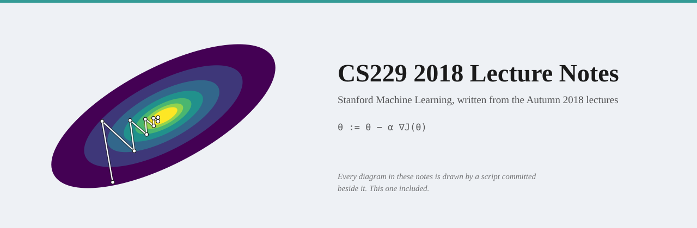

<p align="center">
  
</p>

<h1 align="center">CS229 2018 Lecture Notes</h1>

<p align="center">
  <b>Free lecture notes for Stanford CS229: Machine Learning, written from Andrew Ng's Autumn 2018 lectures.</b><br>
  The derivations worked at the board, the intuition given out loud, and a timestamp into the video for every section.
</p>

<h3 align="center">
  <a href="https://raimbekovm.github.io/cs229-2018-notes/">Read the notes online</a> ·
  <a href="https://www.youtube.com/playlist?list=PLoROMvodv4rMiGQp3WXShtMGgzqpfVfbU">Watch the lectures</a>
</h3>

<p align="center">
  <a href="https://github.com/raimbekovm/cs229-2018-notes/actions/workflows/publish.yml"></a>
  <a href="LICENSE"></a>
  <a href="CONTRIBUTING.md"></a>
</p>

---

## Lectures

| #   | Lecture | What it covers | Status |
| :-- | :------ | :------------- | :----- |
| 1 | Introduction | What machine learning is, supervised and unsupervised learning, reinforcement learning, and the course map | Planned |
| 2 | Linear Regression and Gradient Descent | Hypotheses and cost functions, batch and stochastic gradient descent, the normal equations | Planned |
| 3 | Locally Weighted and Logistic Regression | Least squares as maximum likelihood, locally weighted regression, logistic regression, Newton's method | Planned |
| 4 | Perceptron and Generalized Linear Models | The perceptron, the exponential family, constructing GLMs, softmax regression | Planned |
| 5 | GDA and Naive Bayes | Generative versus discriminative learning, Gaussian discriminant analysis, naive Bayes | Planned |
| 6 | Support Vector Machines | Laplace smoothing, event models for text, functional and geometric margins, the optimal margin classifier | Planned |
| 7 | Kernels | Lagrange duality, the kernel trick, Mercer's theorem, the soft-margin SVM | Planned |
| 8 | Data Splits, Models and Cross-Validation | Bias and variance, regularization, train/dev/test splits, cross-validation, feature selection | Planned |
| — | Learning Theory | Empirical risk minimization, the union bound and Hoeffding's inequality, uniform convergence, VC dimension | Planned |
| 9 | Decision Trees and Ensemble Methods | Greedy splitting, misclassification and cross-entropy loss, bagging, random forests, boosting | Planned |
| 10 | Introduction to Neural Networks | Logistic regression as a neuron, layers and vectorization, forward propagation | Planned |
| 11 | Backprop and Improving Neural Networks | Backpropagation, activation functions, initialization, normalization, optimizers | Planned |
| 12 | Debugging ML Models and Error Analysis | Bias versus variance diagnostics, optimization versus objective, error analysis, ablative analysis | Planned |
| 13 | Expectation-Maximization Algorithms | k-means, mixtures of Gaussians, the EM algorithm | Planned |
| 14 | EM Algorithm and Factor Analysis | Jensen's inequality and the evidence lower bound, EM as coordinate ascent, factor analysis | Planned |
| 15 | PCA and ICA | Principal component analysis, independent component analysis | Planned |
| 16 | Independent Component Analysis and RL | ICA by maximum likelihood, Markov decision processes, Bellman equations | Planned |
| 17 | MDPs and Value/Policy Iteration | Value iteration, policy iteration, learning a model of the MDP | Planned |
| 18 | Continuous State MDP and Model Simulation | Discretization, simulators, fitted value iteration | Planned |
| 19 | Reward Model and Linear Dynamical System | The linear quadratic regulator, differential dynamic programming, LQG | Planned |
| 20 | RL Debugging and Diagnostics | Diagnosing reinforcement learning systems, from the simulator to the reward | Planned |

Chapters are published as they are written, in course order.

---

## About these notes

Stanford's [CS229](https://cs229.stanford.edu/) is one of the most widely
watched machine learning courses there is, and the
[Autumn 2018 recordings](https://www.youtube.com/playlist?list=PLoROMvodv4rMiGQp3WXShtMGgzqpfVfbU)
with Andrew Ng are the version most people meet. The official class notes are
the formal account of the course; what they cannot carry is the lecture itself —
the order in which an idea is motivated before it is formalised, the picture
drawn to make an update rule obvious, the question from the room that exposes a
skipped step.

These notes are written from the recordings, not summarised from the official
notes. Each chapter is continuous prose with the board derivations written out
in full, every section links to the moment in the video where it is taught, and
where the official notes go further the chapter points to the section to read
next.

This is an **unofficial** resource, not affiliated with Stanford University.
For official course materials see [cs229.stanford.edu](https://cs229.stanford.edu/).

## Found a mistake?

Corrections are genuinely welcome. Every page has an **Edit this page** link at
the bottom that opens a pull request from your browser; for anything larger, open
an [issue](https://github.com/raimbekovm/cs229-2018-notes/issues).
[CONTRIBUTING.md](CONTRIBUTING.md) has the style guide.

## Licence

The writing and the diagrams made for this project are [MIT](LICENSE)-licensed.
Per-figure provenance is in [figures/SOURCES.md](figures/SOURCES.md), and
[NOTICE.md](NOTICE.md) has the full picture.

<details>
<summary><b>Build the site locally</b></summary>

The notes are a [Quarto](https://quarto.org/) book: one `.qmd` per lecture in
`lectures/`, figures generated by scripts in `figures/`, and CI renders the site
and the PDF on every push to `main`.

```bash
quarto preview           # live-reloading site at localhost:4321
quarto render            # full build into _site/ (site + PDF; PDF needs LaTeX)
quarto render --to html  # site only — no LaTeX needed
```

</details>
