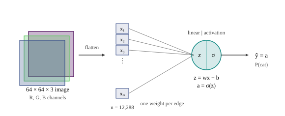
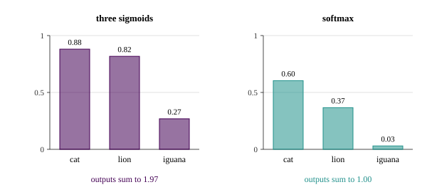
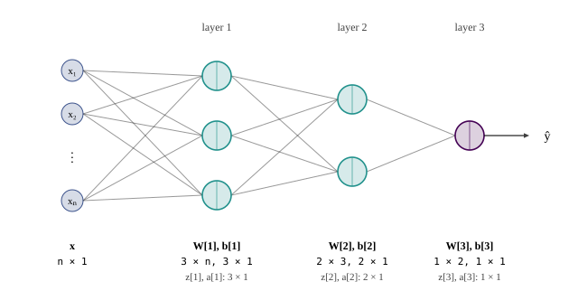

::: {.lecture-video lecture="10"}
:::

*Based on the lecture by Kian Katanforoosh — [CS229](https://cs229.stanford.edu/),
Stanford University, Autumn 2018.*

A neural network is logistic regression repeated and stacked. One neuron computes a
linear function of its inputs and passes the result through a non-linearity; a layer is
several neurons reading the same inputs; a network is layers feeding one another. This
lecture builds that up one step at a time from a classifier the course already has, and
at each step asks the same three questions: what the output means, what the loss must
therefore be, and how many parameters there are. It ends with the forward pass written
in matrices, for one example and for a whole batch, and with the reason gradients are
computed from the last layer backwards, which the next chapter works out in full.

The two deep-learning lectures are given by Kian Katanforoosh, who teaches CS230, the
Stanford deep-learning course. [1:02]{.t} He opens with the usual account of why the
methods took off when they did: GPUs made the computation affordable, the digitised
world made large datasets available, and these models are flexible enough to keep
improving as the data grows, which older methods mostly stop doing.

## Logistic regression as one neuron {#sec-nn-neuron}

[3:05]{.t} The running task is to say whether an image contains a cat: output a number
close to 1 if it does and close to 0 if it does not. A colour image of $64 \times 64$
pixels is three such grids, one per red, green and blue channel, so it is
$64 \cdot 64 \cdot 3 = 12{,}288$ numbers. Logistic regression needs a vector, so the first
step is simply to flatten the image into a column vector $x \in \mathbb{R}^{12288}$, and
then

$$
\hat y = \sigma(wx + b), \qquad \sigma(z) = \frac{1}{1 + e^{-z}}.
$$ {#eq-nn-neuron}

This is the model of @sec-logistic-mle with the intercept split out: $\theta^\top x$ with
a constant feature becomes $wx + b$, where $b$ plays the role of $\theta_0$ and $w$ holds
the rest. [6:03]{.t} Since $\hat y$ is a scalar and $x$ is $12{,}288 \times 1$, $w$ must be a
*row* vector, $1 \times 12{,}288$. The lecture asks for that shape before anything else,
and the habit of checking shapes first carries the whole of the next chapter.

Training is the familiar loop: initialise $w$ and $b$, minimise the logistic loss

$$
L(\hat y, y) = -\bigl[\,y \log \hat y + (1 - y)\log(1 - \hat y)\,\bigr]
$$ {#eq-nn-logloss}

by gradient descent, then predict with the fitted parameters. The loss is the negative
log-likelihood of the Bernoulli model, so minimising it is maximum likelihood. What
Katanforoosh stresses is its role: the function we actually want, the one that recognises
cats, has parameters we cannot write down, and the loss is the proxy we can optimise in
their place.

[10:26]{.t} The model has $12{,}288$ weights and one bias. There is a quicker way to count
that the lecture uses from here on: draw the model with one edge from each input to the
neuron, and there is one weight per edge and one bias per neuron. It also shows something
unwelcome, that the parameter count grows with the size of the input. A larger image
means a larger $w$, and the lecture flags this as something to change later; convolutional
networks, which share weights across the image, are the change.

{#fig-nn-neuron}

[11:34]{.t} Two slogans come out of this. The first is that *a neuron is a linear part
plus an activation*: $z = wx + b$, then $a = g(z)$, with the sigmoid as one choice of $g$
among several. The second is that *a model is an architecture plus parameters*. When a
team says it has shipped a model, it has shipped two files, one describing the
computation and one holding the numbers that computation uses. The rest of the lecture
changes the architecture and lets the parameters, still called $W$ and $b$, grow.

## Three animals, three neurons {#sec-nn-multilabel}

[13:42]{.t} Now the task is to detect a cat, a lion and an iguana. The obvious extension
is to put three neurons side by side, each connected to every pixel, each computing its
own logistic regression:

$$
\hat y_k = a^{[1]}_k = \sigma\bigl(w^{[1]}_k x + b^{[1]}_k\bigr), \qquad k = 1, 2, 3.
$$

The square-bracket superscript names the *layer* and the subscript the neuron within it.
This network has one layer, whose neurons do not talk to one another, and its output
$\hat y$ is now a vector of three numbers. [17:08]{.t} Each neuron has its own weights, so
the parameter count triples, to $3n + 3 = 36{,}867$ for $n = 12{,}288$.

The labels must change with the output. [18:42]{.t} An image of a cat gets $(1, 0, 0)$, a
lion $(0, 1, 0)$, an iguana $(0, 0, 1)$, and the loss is the sum of three logistic losses,
one per entry. Which neuron ends up detecting cats is decided by nothing more than this
labelling convention: the first neuron is only ever compared with the first entry, so it
becomes the cat detector, and had the convention put cats second, the second neuron would
have.

[20:37]{.t} The same observation answers the question of an image showing a cat *and* a
lion. Label it $(1, 1, 0)$ and nothing breaks, because the three neurons are trained
independently; each sigmoid depends only on its own weights, and nothing forces the
outputs to add up to anything. [22:32]{.t} As a student points out, the network is not yet
a network in any interesting sense: it is three logistic regressions that happen to share
an input.

[23:49]{.t} The case where this design is the wrong one is when the classes exclude each
other: a cell image showing exactly one of many diseases, say. The lecture's argument is
that a very rare class, the one iguana in a zoo of thousands of lions and cats, leaves its
neuron almost untrained. That needs one qualification. The iguana neuron does receive a
gradient on every image: the derivative of its logistic loss with respect to its logit is
$\sigma(z_3) - y_3$, which on an image without an iguana is $\sigma(z_3) > 0$ and pushes the
neuron towards saying "no iguana". What the neuron lacks is positive examples, and a
softmax does not create those either. The real reason to prefer a softmax for exclusive
classes is that it builds the exclusivity into the model, which is the subject of the next
section.

## Softmax: one class per image {#sec-nn-softmax}

[25:10]{.t} Add the constraint that each image shows exactly one of the three animals.
Write the linear part of neuron $k$ as $z^{[1]}_k = w^{[1]}_k x + b^{[1]}_k$, drop the three
sigmoids, and replace them by a single function of all three logits:

$$
\hat y_k = \frac{e^{z^{[1]}_k}}{\sum_{j=1}^{3} e^{z^{[1]}_j}}.
$$ {#eq-nn-softmax}

This is the softmax of softmax regression, derived as a generalised linear model in
@sec-softmax. [28:27]{.t} Its outputs are positive and sum to one, so they form a
probability distribution over the classes. It can no longer say "probably a cat and
probably a lion": raising one output lowers the others. Labels are one-hot, $(1,0,0)$,
$(0,1,0)$ or $(0,0,1)$, and the prediction is the class with the largest output.
[30:03]{.t} The constraint also bakes in an assumption that one of the three animals is
always present; if images with none of them can occur, a fourth class for "no animal"
has to be added. The parameter count does not change, since the softmax has no
parameters of its own: still $3n + 3$.

{#fig-nn-softmax}

[33:17]{.t} A student asks what happens if this network is trained on the multi-hot label
$(1, 1, 0)$ anyway. The lecture's guess is that it will settle near $(\tfrac12, \tfrac12,
0)$, and that is exactly right: with the cross-entropy loss below, the best a distribution
can do against two targets of 1 is split its mass equally between them, and the
generator, training a softmax on that label by gradient descent, ends at
$(0.5000, 0.5000, 0.0000)$. The fit can never be exact, because the outputs sum to 1 and
the label sums to 2.

[34:07]{.t} The loss has to change too. For the three independent sigmoids the
derivative of the summed loss with respect to $w^{[1]}_2$ involves only the second term,
since the other two do not depend on $w^{[1]}_2$. Under a softmax every output depends on
every logit through the denominator, so the loss is the *softmax cross-entropy*

$$
L(\hat y, y) = -\sum_{k=1}^{3} y_k \log \hat y_k,
$$ {#eq-nn-ce}

which for a one-hot $y$ is just $-\log$ of the probability given to the right class. The
lecture leaves its derivative as an exercise and suggests it is harder than the
sigmoid case. It looks harder and is not. The coupling through the denominator cancels,
and for a one-hot label the gradient with respect to the logits is

$$
\frac{\partial L}{\partial z^{[1]}_k} = \hat y_k - y_k,
$$ {#eq-nn-ce-grad}

the same form as the logistic loss of one sigmoid neuron, $\sigma(z) - y$. The generator
checks both against finite differences on 500 random logit vectors. This shared form is
not a coincidence: both are canonical-link GLMs (@sec-glm), and it is the reason the
next chapter's backpropagation starts from "prediction minus label" at the output
whichever of the two is used.

## Predicting a number {#sec-nn-regression}

[37:17]{.t} Suppose instead the network has to estimate the cat's age. One answer, from
the room, is to treat each age as a class and use a softmax, since a cat has exactly one
age. The other is to make it a regression, and that changes two things. The sigmoid at
the output has to go, since it confines $\hat y$ to $(0, 1)$. With the identity in its
place, the one-neuron model is linear regression. [39:29]{.t} A better choice here is the
*rectified linear unit*,

$$
\operatorname{ReLU}(z) = \max(0, z),
$$

which is linear for positive inputs and zero for negative ones, a natural fit for a
quantity that cannot be negative. The loss changes as well, to the absolute or squared
error between $\hat y$ and $y$. The lecture's reason is that these are easier to optimise
for regression than the logistic loss would be; the reason from the earlier chapters is
that squared error is the log-likelihood of a Gaussian output, just as the logistic loss
is the log-likelihood of a Bernoulli one, and a student's suggestion of a Poisson output
for counts would pick the matching loss in the same way.

## Hidden layers {#sec-nn-hidden}

[41:16]{.t} Back to cat or no cat, but with more neurons: a layer of three, feeding a
layer of two, feeding one output neuron. [43:00]{.t} The only hard constraint on the
architecture is at the end, where the output layer must have one neuron per number to
be predicted. The parameter count follows from one weight per edge and one bias per
neuron:

$$
\underbrace{3n + 3}_{\text{layer 1}} + \underbrace{2 \cdot 3 + 2}_{\text{layer 2}} + \underbrace{2 + 1}_{\text{layer 3}} = 3n + 14 = 36{,}878.
$$

Adding two layers cost eleven parameters; $99.97\,\%$ of the network is still the first
layer, because that is the layer that touches all $12{,}288$ pixels.

[44:31]{.t} Some vocabulary. A *layer* is a set of neurons that are not connected to one
another. Katanforoosh calls the first layer of neurons the input layer, the last the
output layer, and the one between a *hidden* layer; the official notes, and this book,
instead treat the input $x$ as layer 0 and count only layers of neurons, which gives the
same three. His reason for "hidden" is that the layer sees neither the input nor the
label, only what the previous layer hands it. The more common reading is about the
training data: it supplies values for the inputs and the outputs and never for these
units, so what they compute is not specified by anyone.

[45:31]{.t} What they do compute, in a network trained on enough cat images, is usually
described as a hierarchy: neurons early on respond to edges, later ones combine edges into
ears and eyes, and the output combines those into a face. [1:03:48]{.t} A student later
asks why the first layer should find edges, and the lecture's answer is that those
neurons see only pixels, which is too granular to see more. For the network on the board
that argument does not hold. Each neuron of a fully connected first layer is a weighted sum
of *all* $12{,}288$ pixels, a template the size of the whole image, and nothing prevents
that template from looking like a face. The edge story comes from convolutional networks,
whose first-layer neurons each look at a small patch of the image; for them a local
pattern such as an edge is about all a single neuron can represent, and there the
argument is right.

[46:44]{.t} The second example makes the point about hidden units from the other side.
Predict a house's price from its size, number of bedrooms, zip code and the wealth of the
neighbourhood. An engineer wiring the network by hand would give each hidden neuron a
job: size and bedrooms say how large a family fits, the zip code says how walkable the
area is, the zip code and wealth say how good the nearby school is, and those three
predict the price better than the raw inputs. [48:51]{.t} A *fully connected* layer
instead links every input to every neuron of the next layer and lets training decide what
each hidden neuron computes. It often finds better features than the hand-designed ones,
at the price of not saying what they are, which is why neural networks get called black
boxes. Training only from input to label, with nothing constrained in between, is what
*end-to-end learning* means.

{#fig-nn-house}

## Forward propagation and shapes {#sec-nn-forward}

[51:31]{.t} For the three-layer cat network, pushing one example from input to output is
six lines, each layer a linear part and an activation:

$$
\begin{aligned}
z^{[1]} &= W^{[1]} x + b^{[1]}, & a^{[1]} &= \sigma\bigl(z^{[1]}\bigr),\\
z^{[2]} &= W^{[2]} a^{[1]} + b^{[2]}, & a^{[2]} &= \sigma\bigl(z^{[2]}\bigr),\\
z^{[3]} &= W^{[3]} a^{[2]} + b^{[3]}, & \hat y = a^{[3]} &= \sigma\bigl(z^{[3]}\bigr).
\end{aligned}
$$ {#eq-nn-forward}

This is *forward propagation*. Where @sec-nn-multilabel wrote one equation per neuron,
these write one per layer: $W^{[1]}$ stacks the three neurons' weight rows into a matrix,
and the sigmoid is applied entry by entry.

[53:13]{.t} The shapes follow from two facts, that $z^{[l]}$ has one entry per neuron in
layer $l$ and that $W^{[l]}$ must turn the previous layer's activations into it. So $z^{[1]}$
is $3 \times 1$ and $x$ is $n \times 1$, which forces $W^{[1]}$ to be $3 \times n$; $a^{[1]}$ is
$3 \times 1$ and $z^{[2]}$ is $2 \times 1$, so $W^{[2]}$ is $2 \times 3$, one entry per edge
between the layers; and $W^{[3]}$ is $1 \times 2$. In general $W^{[l]}$ is $n_l \times n_{l-1}$
and $b^{[l]}$ is $n_l \times 1$, where $n_l$ is the width of layer $l$. Katanforoosh's advice
is to know every shape in the network before writing a line of code, and it is the tool
that makes the next chapter's derivatives come out right.

{#fig-nn-shapes}

## Vectorising over a batch {#sec-nn-vectorise}

[54:59]{.t} Recall the two ends of gradient descent from @sec-sgd: stochastic gradient
descent updates after every example, with a noisy direction; batch gradient descent
updates after seeing all of them, with an accurate one. Either way, a network with many
layers does a lot of arithmetic per example, and the way to make that fast is to process
many examples in one set of matrix operations rather than in a loop.

[55:59]{.t} Stack $m$ examples as the columns of an $n \times m$ matrix $X = [x^{(1)} \cdots
x^{(m)}]$, using round-bracket superscripts for the example and square brackets for the
layer. Then the first layer for the whole batch is

$$
Z^{[1]} = W^{[1]} X + b^{[1]},
$$ {#eq-nn-batch}

and $Z^{[1]}$ is $3 \times m$, its $i$-th column the $z^{[1]}$ of example $i$. $W^{[1]}$ is still
$3 \times n$: [59:21]{.t} feeding the network a thousand images does not give it more
parameters. [59:36]{.t} But that leaves @eq-nn-batch adding a $3 \times m$ matrix to a $3
\times 1$ vector, which is not defined. The fix is *broadcasting*: read $b^{[1]}$ as the
$3 \times m$ matrix whose columns are all $b^{[1]}$, so the same bias is added to every
example. NumPy does this automatically when the shapes are compatible. The generator
checks that the broadcast batch computation gives column for column what the per-example
loop gives. The remaining lines of @eq-nn-forward become capital-letter versions in the
same way; the lecture leaves writing them out, with their shapes, as an exercise.

Two student questions in this stretch are worth keeping. [1:03:05]{.t} One asks how this
differs from principal component analysis, which also builds new features from the
inputs. PCA is unsupervised: it finds the directions along which the inputs vary most and
never looks at a label. The hidden layer is trained to predict $y$, and a direction of
large input variance that does not help with that is of no interest to it.

[1:05:53]{.t} The other asks how to choose the number of layers and neurons. Nobody knows
in advance, so the honest answer is to train several architectures and compare them on
the validation set, as in @sec-dev-test. Experience narrows the search: a harder problem
needs more data and a deeper network, and judging which problem is harder is a skill.
Telling cats from non-cats seems harder than telling day from night, since cats come in
many breeds and nights do not, though even day or night has its trap, a photo taken
indoors next to a small window.

## The cost, and why backpropagation starts at the end {#sec-nn-cost}

[1:09:06]{.t} With the architecture fixed, what is left is to find its parameters
$W^{[1]}, b^{[1]}, \dots, W^{[3]}, b^{[3]}$. The objective over a batch is the average loss,

$$
J(\hat Y, Y) = \frac{1}{m} \sum_{i=1}^{m} L\bigl(\hat y^{(i)}, y^{(i)}\bigr),
$$ {#eq-nn-cost}

with $L$ the logistic loss of @eq-nn-logloss. The lecture keeps the words apart: the
*loss* is the error on one example, the *cost* the average over a batch.
[1:11:13]{.t} Differentiation is linear, so the gradient of $J$ is the average of the
gradients of the per-example losses, and it is enough to work out derivatives of $L$
and average at the end. The generator confirms this numerically.

[1:12:55]{.t} Gradient descent then updates every layer,

$$
W^{[l]} \leftarrow W^{[l]} - \alpha \frac{\partial J}{\partial W^{[l]}}, \qquad
b^{[l]} \leftarrow b^{[l]} - \alpha \frac{\partial J}{\partial b^{[l]}}, \qquad l = 1, 2, 3,
$$ {#eq-nn-update}

which needs six derivatives. [1:14:13]{.t} Asked which to compute first, the room
suggests $W^{[1]}$, and Katanforoosh argues for $W^{[3]}$. It is the closest to the loss, so
its effect on $J$ passes through the fewest functions, while $W^{[1]}$ affects $J$ through
every layer above it. Splitting the derivative along the chain of the forward pass,

$$
\frac{\partial L}{\partial W^{[3]}} =
\frac{\partial L}{\partial a^{[3]}}\,
\frac{\partial a^{[3]}}{\partial z^{[3]}}\,
\frac{\partial z^{[3]}}{\partial W^{[3]}},
$$

every factor is easy, and the first two together are $\partial L / \partial z^{[3]}$.
[1:17:33]{.t} The next layer down needs exactly that quantity again:

$$
\frac{\partial L}{\partial W^{[2]}} =
\frac{\partial L}{\partial z^{[3]}}\,
\frac{\partial z^{[3]}}{\partial a^{[2]}}\,
\frac{\partial a^{[2]}}{\partial z^{[2]}}\,
\frac{\partial z^{[2]}}{\partial W^{[2]}},
$$

so it is computed once and reused, and the same happens one layer further down with
$\partial L / \partial z^{[2]}$. That is the whole idea of *backpropagation*: start at the
loss, apply the chain rule one layer at a time, and carry the error backwards instead of
recomputing it. [1:18:42]{.t} The forward equations say which path the chain must take.
$z^{[3]}$ depends on $W^{[2]}$ only through $a^{[2]}$, so the chain for $W^{[2]}$ runs through
$a^{[2]}$ and not through $W^{[3]}$, which is a dead end. The derivation, with the shapes
that make the products well defined, is the first half of @sec-bp-output in the next
chapter.

::: {.callout-note title="In the official notes"}
cs229-notes-deep_learning, section 1, builds the network from the housing example;
section 2 vectorises the output computation and the computation over training examples;
section 3.1 counts the parameters of the three-layer network ($3n + 14$) and explains why
they cannot all start at zero. The backpropagation derivation is in section 3 and in the
separate cs229-notes-backprop.
:::
