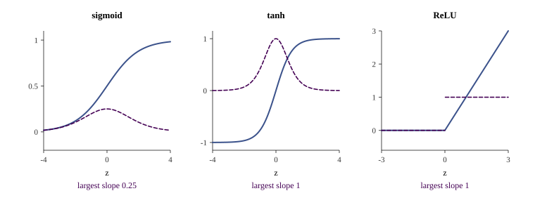
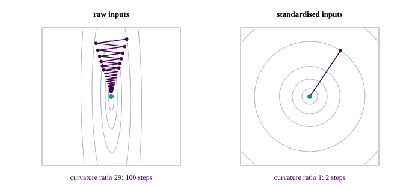
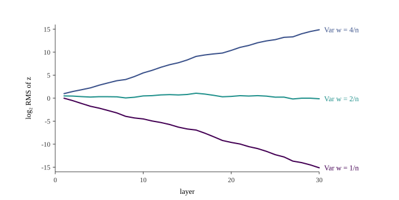
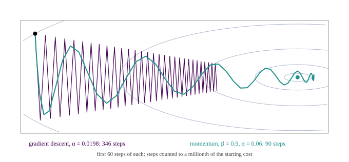

::: {.lecture-video lecture="11"}
:::

*Based on the lecture by Kian Katanforoosh — [CS229](https://cs229.stanford.edu/),
Stanford University, Autumn 2018.*

Backpropagation is the chain rule applied one layer at a time from the loss downwards,
with each layer's intermediate result handed to the layer below instead of being
recomputed. For the three-layer network of the previous chapter it comes down to one
recurrence: the error at the output is prediction minus label, and each layer's error is
the next layer's error carried back through the transposed weights and multiplied entry
by entry by the slope of the activation. The first third of the lecture derives that by
hand. The rest is about why a network that computes its gradients correctly can still
fail to train, and the standard remedies: the choice of activation, normalised inputs,
initial weights of the right size, mini-batches and momentum.

The lecture continues the previous one, again given by Kian Katanforoosh, on the same
running example: a $64 \times 64$ colour image flattened into $x \in \mathbb{R}^n$, a layer
of three sigmoid neurons, a layer of two, and one sigmoid output that says whether the
image shows a cat (@sec-nn-forward).

## The gradient at the output {#sec-bp-output}

[5:41]{.t} The cost is the average of the per-example logistic losses, and since
differentiation is linear it is enough to differentiate one loss and average at the end
(@sec-nn-cost). Write the loss for one example with the output layer spelled out,

$$
L = -\Bigl[\,y \log \sigma\bigl(W^{[3]} a^{[2]} + b^{[3]}\bigr) + (1 - y)\log\Bigl(1 - \sigma\bigl(W^{[3]} a^{[2]} + b^{[3]}\bigr)\Bigr)\Bigr],
$$

and differentiate with respect to $W^{[3]}$, the parameter closest to it. Each term is a
logarithm of a sigmoid of a linear function, so the chain rule gives three factors: $1/a^{[3]}$
from the logarithm, $a^{[3]}(1 - a^{[3]})$ from the sigmoid, whose derivative is
$\sigma'(z) = \sigma(z)\bigl(1 - \sigma(z)\bigr)$, and the derivative of $W^{[3]} a^{[2]} + b^{[3]}$
with respect to $W^{[3]}$. The second term is the same with $1/(1 - a^{[3]})$ and a minus
sign. [15:46]{.t} The sigmoid factors cancel against the logarithm's, the cross terms
cancel against each other, and what is left is

$$
\frac{\partial L}{\partial W^{[3]}} = \bigl(a^{[3]} - y\bigr)\, a^{[2]\top}.
$$ {#eq-bp-w3}

The result "doesn't look that bad," as Katanforoosh puts it, and it is the same
prediction-minus-label form as logistic regression (@eq-nn-ce-grad), with the
activations of the layer below standing in for the input.

[12:05]{.t} A student asks where the transpose comes from. The answer is a shape
argument, and it is the tool for the rest of the derivation. $L$ is a scalar and $W^{[3]}$ is
$1 \times 2$, so the derivative of one with respect to the other has one entry per entry of
$W^{[3]}$ and must be $1 \times 2$ as well. In scalar calculus the derivative of $wa$ with
respect to $w$ is $a$; here $a^{[2]}$ is $2 \times 1$, which is the wrong shape, so the
answer has to be $a^{[2]\top}$. Either learn the matrix-calculus identities by heart, or
learn to check shapes. The bias works the same way and gives
$\partial L / \partial b^{[3]} = a^{[3]} - y$. Averaging over a batch, the cost's gradient is
$\frac1m \sum_i (a^{[3](i)} - y^{(i)})\, a^{[2](i)\top}$, which in the matrix notation of
@sec-nn-vectorise is the single product $\frac1m (A^{[3]} - Y) A^{[2]\top}$: the sum over
examples is done by the matrix multiplication.

## The chain rule, one layer down {#sec-bp-chain}

[19:05]{.t} For $W^{[2]}$ the lecture does not start over. It decomposes the derivative
along the path that connects $W^{[2]}$ to the loss in the forward equations:

$$
\frac{\partial L}{\partial W^{[2]}} =
\underbrace{\frac{\partial L}{\partial a^{[3]}}\,\frac{\partial a^{[3]}}{\partial z^{[3]}}}_{\partial L/\partial z^{[3]}}\,
\frac{\partial z^{[3]}}{\partial a^{[2]}}\,
\frac{\partial a^{[2]}}{\partial z^{[2]}}\,
\frac{\partial z^{[2]}}{\partial W^{[2]}}.
$$

[20:24]{.t} The path has to go through $a^{[2]}$. $z^{[3]} = W^{[3]} a^{[2]} + b^{[3]}$ also depends on
$W^{[3]}$ and $b^{[3]}$, but differentiating with respect to those leads nowhere: they do not
depend on $W^{[2]}$, and the error has to travel through variables that do.
[22:04]{.t} Asked which part of this is already known, a student says the first three
factors and then corrects it to two, which is right: since
$\partial L / \partial W^{[3]} = (\partial L / \partial z^{[3]})\, a^{[2]\top}$, @eq-bp-w3 says
$\partial L / \partial z^{[3]} = a^{[3]} - y$. The remaining factors are each one step of the
forward pass. $\partial a^{[2]}/\partial z^{[2]}$ is the sigmoid's derivative, $a^{[2]} \circ (1 - a^{[2]})$;
$\partial z^{[2]} / \partial W^{[2]}$ brings in $a^{[1]\top}$ as before; and
[25:24]{.t} $\partial z^{[3]}/\partial a^{[2]}$ is $W^{[3]}$ or its transpose, which the shapes decide:
$z^{[3]}$ is a scalar and $a^{[2]}$ is $2 \times 1$, so the factor is the $2 \times 1$ vector
$W^{[3]\top}$.

[28:01]{.t} Written in the order the chain rule produced them, the factors are
$1 \times 1$, $2 \times 1$, $2 \times 1$ and $1 \times 3$, and they do not multiply. The
derivation so far was a bookkeeping of which quantities appear, not of how they combine.
Two facts put them together. The sigmoid acts on each entry of $z^{[2]}$ separately, so its
derivative enters as an entry-by-entry product, written $\circ$, and that is true of every
activation. And the result must have the shape of $W^{[2]}$, $2 \times 3$, which fixes the
order of the rest:

$$
\frac{\partial L}{\partial W^{[2]}} = \Bigl(W^{[3]\top}\bigl(a^{[3]} - y\bigr) \circ a^{[2]} \circ \bigl(1 - a^{[2]}\bigr)\Bigr)\, a^{[1]\top}.
$$ {#eq-bp-w2}

Inside the parentheses is a $2 \times 1$ vector, $\partial L/\partial z^{[2]}$, and the outer
product with the $1 \times 3$ vector $a^{[1]\top}$ gives $2 \times 3$. The lecture leaves $W^{[1]}$
as an exercise; it comes out the same way, and the pattern is worth stating once in
general. Write $\delta^{[l]} = \partial L / \partial z^{[l]}$ for the error at layer $l$ of an
$N$-layer network with activation $g$. Then

$$
\delta^{[N]} = a^{[N]} - y, \qquad
\delta^{[l]} = \bigl(W^{[l+1]\top} \delta^{[l+1]}\bigr) \circ g'\bigl(z^{[l]}\bigr), \qquad
\frac{\partial L}{\partial W^{[l]}} = \delta^{[l]}\, a^{[l-1]\top}, \qquad
\frac{\partial L}{\partial b^{[l]}} = \delta^{[l]},
$$ {#eq-bp-recurrence}

with $a^{[0]} = x$. The first equation holds for a sigmoid output with the logistic loss
and for a softmax with cross-entropy alike. The generator implements exactly these four
lines for the 3-2-1 sigmoid network and compares every one of its parameters' gradients
with finite differences on fifty random networks; the worst disagreement is $4 \times
10^{-10}$.

[31:21]{.t} Katanforoosh's view is that hardly anyone derives these by hand any more,
since programming frameworks differentiate automatically, but that it is worth having done
once, both to understand what the framework is doing and to read papers that write
gradients out. For the rigorous version he points to the lecture notes.

## What the forward pass must keep {#sec-bp-cache}

[32:04]{.t} Every factor in @eq-bp-recurrence other than $\delta$ itself is something the
forward pass already computed: the activations $a^{[1]}, a^{[2]}, a^{[3]}$, the values
$g'(z^{[l]})$ depend on, and the weights. Discard them and the backward pass would have to
re-run the forward pass from $x$ each time it needed one, going forwards again to reach
$a^{[2]}$, then again to reach $a^{[1]}$. So the forward pass *caches* what it computes and
the backward pass reads it. This is a trade of memory for computation, and the memory is
not small: every activation of every layer for every example in the batch is held until
the backward pass reaches it.

![Forward pass on top, left to right, caching each value. Backward pass below, right to left: the output error $\delta^{[3]} = a^{[3]} - y$ is carried down by $W^{[l+1]\top}$ and the activation's slope, and each layer's weight gradient is its $\delta$ times the cached activation that fed it.](../figures/11-backprop/diagram_backprop.svg){#fig-bp-backprop}

## Activation functions {#sec-bp-activations}

[34:44]{.t} Getting the gradients right is necessary and nowhere near sufficient; a network
built and differentiated correctly usually still trains badly, and the rest of the lecture
is the set of practical fixes. The first is the choice of activation. There are three in
common use:

$$
\sigma(z) = \frac{1}{1 + e^{-z}}, \qquad
\tanh(z) = \frac{e^{z} - e^{-z}}{e^{z} + e^{-z}}, \qquad
\operatorname{ReLU}(z) = \max(0, z),
$$

with derivatives $\sigma(1 - \sigma)$, $1 - \tanh^2$, and the indicator $\mathbb{1}\{z > 0\}$.
[37:08]{.t} The sigmoid's strength is that its output reads as a probability. Its weakness,
which a student names, is *saturation*: for large positive or negative $z$ the curve is
flat, its derivative is nearly zero, and since that derivative is a factor in every
$\delta$ below it, layers early in the network get almost no gradient and barely move.
The derivative is small even at its best. Its maximum is $\tfrac14$, at $z = 0$, so every
sigmoid layer shrinks the gradient passing through it by at least a factor of four, and
ten of them shrink it by at least $4^{10}$, about a million. tanh saturates in the same way
at both ends, but its slope at the centre is 1 and its output is centred on zero.

[38:52]{.t} ReLU does not saturate for positive inputs: its slope there is exactly 1, so it
passes the gradient through unchanged rather than scaling it down. Its slope for negative
inputs is exactly 0, which has its own cost the lecture does not get to: a ReLU neuron
whose input is negative for every example receives no gradient at all and stops learning.
That trade has worked out well enough that ReLU is the usual choice for hidden layers.

{#fig-bp-activations}

[39:53]{.t} For the *output* layer the choice is made by the range of what is predicted,
not by trainability: a sigmoid for a probability in $(0, 1)$, tanh for values in $(-1, 1)$
such as the rewards of reinforcement learning, a ReLU for a non-negative quantity such as
a house price, the identity for an unrestricted one. [45:18]{.t} Within a hidden layer
the convention is one activation for every neuron, so that a layer is described as, say,
a fully connected ReLU layer. People have tried mixing activations inside a layer without
finding a reason to, and the choice is treated as a hyperparameter like any other,
settled by experiment rather than by theory.

## Why the network needs a non-linearity {#sec-bp-nonlinear}

[41:06]{.t} A student asks why these particular functions, and Katanforoosh answers by
taking the activation away. With the identity in every neuron of the 3-2-1 network the
forward pass substitutes into itself:

$$
\hat y = W^{[3]}\Bigl(W^{[2]}\bigl(W^{[1]}x + b^{[1]}\bigr) + b^{[2]}\Bigr) + b^{[3]}
= \underbrace{W^{[3]}W^{[2]}W^{[1]}}_{W}\,x + \underbrace{W^{[3]}W^{[2]}b^{[1]} + W^{[3]}b^{[2]} + b^{[3]}}_{b}.
$$ {#eq-bp-collapse}

[43:52]{.t} Three layers of parameters compute exactly what one layer computes, an affine
function $Wx + b$, and adding layers changes nothing: however deep, the network is a
linear regression. The capacity of a network to represent complicated functions comes
entirely from its activations. The lecture's phrasing is that any function but the
identity will do; strictly, the problem is any affine activation, since $g(z) = cz + d$
collapses in the same way, and what is needed is a non-linear one. The generator confirms
the collapse on random inputs to machine precision.

## Normalising the inputs {#sec-bp-normalise}

[48:16]{.t} If the inputs are large, $z = Wx + b$ is large and the sigmoids saturate before
training starts. The simple remedy is to standardise the inputs using the training set:
compute the mean and variance of each feature,

$$
\mu = \frac1m \sum_{i=1}^{m} x^{(i)}, \qquad
\sigma^2 = \frac1m \sum_{i=1}^{m} \bigl(x^{(i)} - \mu\bigr)^2,
$$

entry by entry, and replace every $x$ by $(x - \mu)/\sigma$. Subtracting $\mu$ centres the
cloud of points on the origin; dividing by $\sigma$ gives every feature the same spread.

[51:18]{.t} The second reason is the shape of the cost. When features have very different
scales, or sit far from zero, the cost is a long narrow valley in parameter space, and
gradient descent, which moves perpendicular to the contours, crosses the valley again and
again while making slow progress along it. After standardising, the contours are closer to
circles, the gradient points nearly at the minimum, and descent goes almost straight
there. @fig-bp-normalise makes the comparison on a least-squares problem with two
features, one centred at 2 and the other on a small scale. The ratio of the cost's
curvatures along its two axes is 29 with the raw inputs and 1 after standardising, and
gradient descent, each run at its best fixed learning rate, needs 100 steps against 2.
Standardising equalises scales, not correlations: afterwards the curvature matrix of a
least-squares cost is the features' correlation matrix, so two strongly correlated
features still leave a long valley, tilted at 45°, which decorrelating transforms such as
the PCA of a later chapter address.

{#fig-bp-normalise}

[53:03]{.t} One rule matters more than the formulas: $\mu$ and $\sigma$ are computed on the
training set and then reused, unchanged, on the dev and test sets. The network has
learned to expect inputs transformed in one particular way, and normalising the test set
by its own statistics would feed it a differently transformed input.

## Vanishing and exploding gradients {#sec-bp-vanishing}

[54:19]{.t} To see why depth makes all of this harder, take a network of ten layers with
two neurons each, identity activations and zero biases. The output is then the input
multiplied by every weight matrix in turn,

$$
\hat y = W^{[N]} W^{[N-1]} \cdots W^{[1]} x.
$$

[56:05]{.t} If every $W^{[l]}$ is a little larger than the identity, say $1.5\,I$, the product
is $1.5^{N} I$, which for $N = 10$ is about $58$; if every one is $0.5\,I$, it is $0.5^{10}
\approx 0.001$. Small departures from 1 compound geometrically. [57:16]{.t} The same products
appear in the backward pass, because @eq-bp-recurrence multiplies by $W^{[l+1]\top}$ and by
$g'$ once per layer, so the gradients reaching the early layers either explode or vanish.
With sigmoids the $g'$ factors alone contribute at most $\tfrac14$ each
(@sec-bp-activations). Nothing in the gradient computation is wrong; the arithmetic is
simply unforgiving over many layers.

## Initialising the weights {#sec-bp-init}

[58:24]{.t} The lecture's goal is to keep each layer's multiplier "close to 1", which needs
a little care, because that is a statement about the layer and not about individual
weights. A neuron computes $z = \sum_{i=1}^{n} w_i x_i$, a sum of $n$ terms, and the more
inputs it has, the larger $z$ gets unless the weights shrink to compensate. Make that
precise: if the weights and inputs are independent with mean zero, then

$$
\operatorname{Var}(z) = n \operatorname{Var}(w)\operatorname{Var}(x),
$$

so $z$ has the same variance as its inputs when $\operatorname{Var}(w) = 1/n$, or standard
deviation $1/\sqrt{n}$. The lecture's code multiplies standard normal draws by
$\sqrt{1/n^{[l-1]}}$, where $n^{[l-1]}$ is the number of inputs to layer $l$. The generator
checks the variance identity by simulation, getting $0.96$ against $1$.

[1:02:07]{.t} Katanforoosh reports, as an empirical observation, that a ReLU network trains
better with $2$ in place of $1$. There is a clean reason, given by
[He et al. (2015)](https://arxiv.org/abs/1502.01852): a ReLU zeroes the negative half of a
symmetric input, which halves the mean square of what it passes on, so the variance needs
to start twice as large to come out the same. @fig-bp-init shows how quickly this matters.
In a 30-layer ReLU network with weights of variance $1/n$, the signal loses half its mean
square at every layer and ends about $2^{-15}$ of its starting size; with $4/n$ it grows by
the same factor; with $2/n$ it stays level.

{#fig-bp-init}

[1:02:38]{.t} The lecture then presents "Xavier initialisation" and "Glorot initialisation"
as two different schemes. They are one person's name: the method is from
[Glorot and Bengio (2010)](https://proceedings.mlr.press/v9/glorot10a.html), whose first
author is Xavier Glorot. The paper asks for two things at once, that activations keep their
variance going forwards, which needs $n_{\text{in}} \operatorname{Var}(w) = 1$, and that
gradients keep theirs going backwards, which needs $n_{\text{out}} \operatorname{Var}(w) = 1$.
Both cannot hold unless the layer is square, and the compromise it proposes is

$$
\operatorname{Var}(w) = \frac{2}{n_{\text{in}} + n_{\text{out}}},
$$

the reciprocal of the *arithmetic* mean of the fan-in and fan-out (the lecture says a
geometric average). This is the formula the official notes give, under the name
"Xavier/He", though He's $2/n$ is a different rule for a different activation. Glorot and
Bengio derived theirs for tanh-like units; for ReLU networks, He's is the one that holds the
variance.

[1:04:02]{.t} Finally, the initial weights must be *random*, and not merely small. If all
the weights of a layer start equal, every neuron in it computes the same function, receives
the same gradient, and is updated identically, forever: the layer behaves as a single
neuron, however wide it is. The generator trains the 3-2-1 network from equal weights for
6,000 steps of stochastic gradient descent, and the three hidden neurons' weights end up
identical to the last bit. Starting from zero is the extreme case, and the official notes
work it through. Random initial values break the symmetry, so that the neurons start in
different places and can learn different things; biases have no such problem and can
start at zero.

## Mini-batch gradient descent {#sec-bp-minibatch}

[1:05:16]{.t} The two versions of gradient descent seen so far sit at opposite extremes.
Batch gradient descent vectorises well but makes one update per pass through the data,
and with a million images one update is very slow. Stochastic gradient descent updates
after every example, quickly but noisily, and gives up vectorisation. *Mini-batch*
gradient descent takes the middle. Split the training set into batches, written with
curly braces, $X^{\{1\}}, \dots, X^{\{T\}}$, of 1,000 examples each, and loop:

1. pick a batch $\bigl(X^{\{t\}}, Y^{\{t\}}\bigr)$;
2. forward-propagate the whole batch and compute its cost
   $J^{\{t\}} = \frac{1}{1000} \sum_{i} L\bigl(\hat y^{(i)}, y^{(i)}\bigr)$;
3. backpropagate to get the gradients of $J^{\{t\}}$;
4. update $W^{[l]}$ and $b^{[l]}$ for every layer.

Each update is a matrix computation over a thousand examples, which a GPU does at once,
and a thousand examples already give a useful estimate of the direction to move in.
[1:09:30]{.t} The price is noise. Plotted against iterations, the cost of batch gradient
descent falls smoothly, while that of mini-batch descent falls on average but wobbles,
since each step follows one batch's estimate of the gradient. The smaller the batch, the
larger the wobble, and quantitatively: for batches drawn at random, the variance of the
gradient estimate is inversely proportional to the batch size. On a toy regression the
generator measures 9.9, 0.98 and 0.10 for batches of 1, 10 and 100.

## Momentum {#sec-bp-momentum}

[1:11:24]{.t} Return to the long narrow valley of @sec-bp-normalise. Gradient descent zig-zags
across it because the steep direction dominates every gradient, and the useful step would
be large along the valley and small across it. *Momentum* gets there by looking at the
history of updates. [1:13:27]{.t} Averaged over a few steps, the components across the
valley alternate in sign and cancel, while the components along it all point the same way
and add up. Stepping along the average rather than the latest gradient damps the zig-zag
and builds up speed along the floor. In the lecture's form,

$$
v \leftarrow \beta v + (1 - \beta)\,\frac{\partial J}{\partial W}, \qquad
W \leftarrow W - \alpha v,
$$ {#eq-bp-momentum}

where $v$, the velocity, is an exponentially weighted average of past gradients, and
$\beta$, often around 0.9, sets how long a memory it has. [1:15:42]{.t} It costs one more
line of code and one more variable per parameter. The physical picture is a heavy ball
rolling downhill: its velocity cannot reverse at every bump, and $1 - \beta$ plays the part
of friction.

A computation sharpens the picture in a way the lecture does not. In this form, at the
*same* learning rate as gradient descent, momentum helps only modestly: on a quadratic
100 times steeper across the valley than along it, gradient descent at its best fixed rate
takes 346 steps to converge and momentum with $\beta = 0.9$ at that rate takes 272. The
large gain comes from what momentum makes possible. Gradient descent diverges as soon as
$\alpha$ exceeds $2/\lambda_{\max}$, here $0.02$, while the averaging raises the limit to
$2(1 + \beta) / \bigl((1 - \beta)\lambda_{\max}\bigr)$, here $0.38$. At $\alpha = 0.06$,
three times the rate that makes gradient descent blow up, momentum converges in 90 steps.

{#fig-bp-momentum}

[1:15:58]{.t} The optimisers used most in practice, RMSProp and Adam, go further and give
every parameter its own effective learning rate, scaled by a running average of its squared
gradients. [Adam](https://arxiv.org/abs/1412.6980) combines that scaling with momentum. The
lecture's closing point about them is a sociological one: a new optimiser has to prove
itself across a wide range of problems before people adopt it, which is why so few are in
common use.

::: {.callout-note title="In the official notes"}
cs229-notes-backprop derives the backward recurrence for a network of any depth, with
the matrix calculus the lecture replaces by shape analysis. cs229-notes-deep_learning, section 3,
covers backpropagation for the three-layer network; section 3.1 the parameter count,
why zero and equal initialisations fail, and the variance-scaled initialisation; section
3.2 stochastic and mini-batch gradient descent and momentum; and section 3.3, which the
lecture did not reach, L2 regularisation and parameter sharing.
:::
