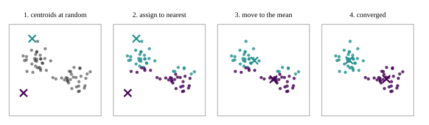
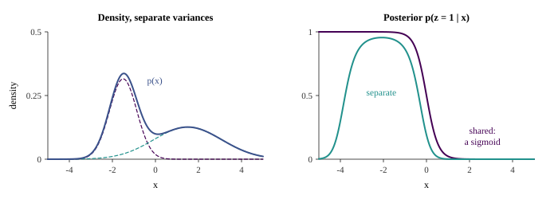
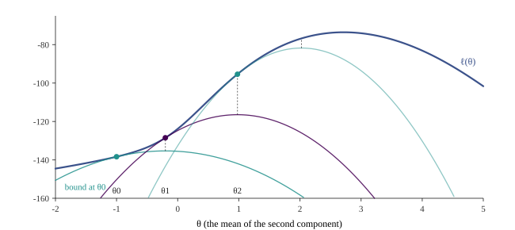

::: {.lecture-video lecture="13"}
:::

*Based on the lecture by Andrew Ng — [CS229](https://cs229.stanford.edu/), Stanford
University, Autumn 2018.*

In unsupervised learning the training set is $\{x^{(1)}, \dots, x^{(m)}\}$ with no labels,
and the job is to find structure in it. This lecture builds two algorithms that alternate
between a guess about hidden structure and a fit given that guess. *k-means* guesses which
cluster each point belongs to and moves each cluster's centre to the mean of its points.
The *EM algorithm* for a mixture of Gaussians does the same with probabilities instead of
hard assignments. The second half derives EM in general. Each E-step builds a lower bound
on the log-likelihood that touches it at the current parameters, and each M-step
maximises that bound, so the likelihood can never decrease. Jensen's inequality is the
tool that makes the bound.

The same derivation carries the next lecture's factor analysis, which is why Ng gives it
in full rather than stopping at the intuitive version.

## k-means {#sec-em-kmeans}

[2:19]{.t} Ng opens with an animation (@fig-em-kmeans). Given unlabelled points that seem
to form two groups, place two *cluster centroids* at random. Then repeat two steps:
colour every point by the centroid it is closer to, and move each centroid to the mean of
the points of its colour. After a few rounds the colours stop changing and the centroids
stop moving, and the algorithm has converged.

{#fig-em-kmeans}

[5:42]{.t} Written out, the algorithm is:

1. Initialise the cluster centroids $\mu_1, \dots, \mu_k \in \mathbb{R}^n$.
2. Repeat until convergence:
   - for every $i$, set $c^{(i)} := \arg\min_j \lVert x^{(i)} - \mu_j \rVert^2$;
   - for every $j$, set
     $\mu_j := \dfrac{\sum_{i} 1\{c^{(i)} = j\}\, x^{(i)}}{\sum_i 1\{c^{(i)} = j\}}$.

The first inner step assigns each example to its nearest centroid. The second moves each
centroid to the average of the examples assigned to it. [6:23]{.t} The animation drops the
initial centroids at arbitrary positions, but Ng points out that the usual practice is to
set them to $k$ training examples chosen at random. In two dimensions this hardly matters,
but in high dimensions a random vector tends to land far from all the data and capture no
points.

The most common use Ng names is market segmentation: group a website's users into types
that can be targeted differently, without anyone having labelled what the types are. The
Google News clustering of stories from the first lecture is another.

## The cost k-means descends {#sec-em-kmeans-cost}

[11:45]{.t} k-means is guaranteed to converge, and the proof is a cost function. Define the
*distortion*

$$
J(c, \mu) = \sum_{i=1}^m \bigl\lVert x^{(i)} - \mu_{c^{(i)}} \bigr\rVert^2 ,
$$ {#eq-em-distortion}

the total squared distance from each point to the centroid it is assigned to. The
assignment step minimises $J$ over $c$ with $\mu$ fixed, since each term is minimised
separately by choosing the nearest centroid. The update step minimises $J$ over $\mu$ with
$c$ fixed, because the point that minimises a sum of squared distances to a set of points
is their mean. So k-means is coordinate descent on $J$, and $J$ never increases. Since it
is bounded below by zero, it must converge. The generator tracks $J$ after every half-step
of every run and confirms it never rises. In @fig-em-kmeans it falls from 476.9 to 31.3
in three rounds. On very large data sets, Ng adds, people often stop once the decrease in
$J$ has become small, without waiting for convergence.

[8:49]{.t} A student asks whether the norm in the circulated notes is an $L_1$ norm. Ng
says it is $L_2$, the default whenever a norm is written without a subscript, and adds that with or without the square
"the algorithm is the same either way". For the assignment step that is right. Squaring
is monotone on non-negative numbers, so the nearest centroid is the same under
$\lVert\cdot\rVert$ and $\lVert\cdot\rVert^2$, and the generator confirms identical
assignments for 200 random sets of centroids. For the update step it is not. The mean
minimises the sum of *squared* distances. The point that minimises the sum of plain
distances is a different one, the geometric median, so the convergence argument above only
works for the squared cost. The generator finds random starts where moving to the means
*raises* the unsquared cost: 26 of 2,000. So k-means does descend a cost, but it is the
squared one, @eq-em-distortion.

[13:33]{.t} Ng is most often asked how to choose $k$. He usually chooses it by hand, for
two reasons. Unsupervised data is often genuinely ambiguous: the same picture can look
like two clusters to one person and four to another. And criteria that pick $k$
automatically, such as AIC and BIC, answer a question the application did not ask. The
better guide is what the clusters are for. If the marketing team can run four campaigns
but not a hundred, use four clusters. In image compression, choose $k$ by how much
compression you want.

[15:41]{.t} k-means can stop at a local minimum of $J$, since coordinate descent only
guarantees that $J$ stops decreasing. The fix Ng gives is to run it many times from
different random initialisations and keep the run with the lowest $J$. On three
well-separated clusters, the generator's 100 restarts, each initialised at three random
training examples, ended at seven different final costs, from 92.6 to 378.2, and the best
was reached 92 times. Taking the lowest cost over a handful of restarts is therefore cheap
insurance.

## Density estimation and anomalies {#sec-em-anomaly}

[16:18]{.t} A related but different problem is *density estimation*: model $p(x)$ from
unlabelled data. Ng's example comes from friends who worked on aircraft engines. As each
engine comes off the assembly line, measure its vibration and the heat it produces. If a
new engine's measurements fall where $p(x)$ is very small, flag it and send it for
inspection before it is fitted to a plane. The same scheme finds cell towers whose network
traffic has turned strange, and computers sending unusual traffic.

[19:46]{.t} The interesting anomaly in his sketch is one where *neither* feature is
unusual on its own. Many engines vibrate that much, and many run that hot, but few do both.
Only a joint model of $p(x)$ catches it. And the data he draws are L-shaped, which no
single textbook distribution fits. They look instead like two Gaussian blobs, perhaps
engines from two production processes, which is the idea of the next section.

## The mixture of Gaussians {#sec-em-mog}

[24:23]{.t} The model introduces a *latent* random variable $z$, meaning one that exists
but is never observed. For each example,

$$
z^{(i)} \sim \operatorname{Multinomial}(\phi), \qquad
x^{(i)} \mid z^{(i)} = j \;\sim\; \mathcal{N}(\mu_j, \Sigma_j),
$$ {#eq-em-mog}

where $\phi_j = p(z^{(i)} = j)$, $\phi_j \ge 0$, $\sum_j \phi_j = 1$. In words: pick one of $k$
Gaussians with probabilities $\phi$, then draw $x$ from it. The density of $x$ is the
mixture $p(x) = \sum_j \phi_j \, \mathcal{N}(x; \mu_j, \Sigma_j)$, which with enough
components can take almost any shape, such as an L, or a narrow peak beside a wide hump
(@fig-em-mixture, left).

This is Gaussian discriminant analysis (@sec-gda) with two cosmetic differences: $z$
takes $k$ values instead of two, and each component has its own covariance $\Sigma_j$ by
convention, where GDA shared one. The real difference is that GDA's labels $y^{(i)}$ were
observed and $z^{(i)}$ are not. [28:12]{.t} If the $z^{(i)}$ *were* observed, maximum
likelihood would give GDA's closed-form estimates, $\phi_j = \frac1m \sum_i 1\{z^{(i)}=j\}$
and $\mu_j$ the mean of the examples with $z^{(i)} = j$, and $\Sigma_j$ their covariance.
Not knowing which Gaussian each example came from is the whole difficulty.

## EM for the mixture: soft k-means {#sec-em-mog-em}

[30:54]{.t} EM resolves the difficulty with the same bootstrap as k-means. Guess the
$z^{(i)}$, fit the parameters as if the guesses were labels, and repeat. The guesses are
probabilities rather than hard labels.

*E-step.* For each $i$ and $j$, compute the posterior probability that example $i$ came
from component $j$,

$$
w^{(i)}_j := p\bigl(z^{(i)} = j \mid x^{(i)}; \phi, \mu, \Sigma\bigr)
= \frac{\phi_j \, \mathcal{N}(x^{(i)}; \mu_j, \Sigma_j)}{\sum_{l=1}^k \phi_l \, \mathcal{N}(x^{(i)}; \mu_l, \Sigma_l)},
$$ {#eq-em-estep}

which is Bayes' rule, exactly as GDA used it to classify.

*M-step.* Re-estimate the parameters with the GDA formulas, with each indicator
$1\{z^{(i)} = j\}$ replaced by $w^{(i)}_j$:

$$
\phi_j := \frac1m \sum_i w^{(i)}_j, \qquad
\mu_j := \frac{\sum_i w^{(i)}_j x^{(i)}}{\sum_i w^{(i)}_j}, \qquad
\Sigma_j := \frac{\sum_i w^{(i)}_j (x^{(i)} - \mu_j)(x^{(i)} - \mu_j)^\top}{\sum_i w^{(i)}_j}.
$$ {#eq-em-mstep}

[36:30]{.t} The replacement is principled: $w^{(i)}_j$ is the expected value of the
indicator under the current posterior, since the expectation of an indicator is the
probability of its event. [37:10]{.t} Ng's intuition is that this is k-means with *soft
assignment*. k-means gives each point entirely to the nearest centroid, even when it is
only slightly nearer. EM gives it, say, 0.8 to one Gaussian and 0.2 to the other, and each
mean becomes a weighted average in which each point counts with that strength. A student
asks how to think about the weights. Ng's reading is that each point is assigned with
total strength one, split across the components. In the engine story, a point with a 10
per cent chance of coming from process one contributes a tenth of an engine to process
one's Gaussian.

The analogy can be made exact. Give all components the same fixed covariance $\sigma^2 I$
and equal $\phi_j$, and let $\sigma^2 \to 0$. Then the posterior in @eq-em-estep goes to 1
for the nearest mean and 0 for the others, and the mean update becomes k-means' update. In
the generator's one-dimensional example, the largest gap between EM's soft assignments and
k-means' hard ones is $3 \times 10^{-11}$ once $\sigma^2 = 0.01$.

[34:06]{.t} Ng describes the E-step for two classes as a sigmoid: the probability of the
left Gaussian falls smoothly from one to zero across the gap between the means. That is
GDA's result (@sec-gda-logistic), and it holds when the components *share* a covariance.
With equal variances the posterior is exactly $1/(1 + e^{-(ax+b)})$, which the generator
checks to $10^{-12}$. With separate covariances, the convention the model was just given,
$\log(w_1/w_2)$ is quadratic in $x$ rather than linear, and the posterior need not be
monotone. In @fig-em-mixture the left component is narrow and the right one wide. The
posterior of the left component rises to 0.955 near $x = -2.1$ and falls back to 0.003 at
$x = -5$, because far out on either side the wide Gaussian is the likelier source. EM
handles this without any change. It only means "points on the left go to the left
cluster" is not what the E-step computes.

{#fig-em-mixture}

[38:56]{.t} Once fitted, the mixture gives $p(x) = \sum_j p(x, z = j)$ for any new engine,
and a low value flags an anomaly. Ng closes the section with a memory from a summer at
AT&T Bell Labs, of a colleague who had just run EM on a mixture of three Gaussians for the
first time and could not stop showing people what it did.

## Jensen's inequality {#sec-em-jensen}

[48:07]{.t} The argument so far was heuristic: guess the latent variables, then pretend
they were observed. To show that EM really is maximum-likelihood estimation, Ng
needs Jensen's inequality. Let $f$ be convex, meaning $f''(x) \ge 0$, and $X$ a random
variable. Then

$$
f\bigl(\mathbb{E}[X]\bigr) \le \mathbb{E}\bigl[f(X)\bigr].
$$ {#eq-em-jensen}

His example takes $X = 1$ or $X = 5$, each with probability one half. Then
$\mathbb{E}[X] = 3$, and $\mathbb{E}[f(X)]$ is the average of $f(1)$ and $f(5)$, which is
the midpoint of the chord joining those two points of the curve (@fig-em-jensen). A
convex function lies below its chords, so the chord's midpoint is above $f(3)$. Ng admits
that he and his friends do not remember which way the inequality goes. They redraw this
picture every time.

![Jensen's inequality: the chord's midpoint, $\mathbb{E}[f(X)]$, lies above the curve at the mean, $f(\mathbb{E}[X])$.](../figures/13-em-algorithms/diagram_jensen.svg){#fig-em-jensen}

[53:23]{.t} EM also needs the equality case. If $f$ is *strictly* convex, $f'' > 0$, then
equality holds only if $X$ is constant, i.e. $X = \mathbb{E}[X]$ with probability one,
which is the measure theorist's way of saying it. A straight line is convex but not
strictly, and for it equality holds for any $X$. [54:47]{.t} A student asks about a curve
with $f(1) = f(3)$. Equal end values alone change nothing: the chord is then flat, and a
strictly convex curve still dips below it in between. Equality for a non-constant $X$
needs the function to be straight between the values $X$ takes, for instance flat between
1 and 3, and such a function is not strictly convex. The strictness is the hypothesis
that rules this out.

For EM the inequality is used upside down. A concave function is the negative of a
convex one ($f'' \le 0$), and for concave $f$, $f(\mathbb{E}[X]) \ge \mathbb{E}[f(X)]$,
with equality for strictly concave $f$ only when $X$ is constant. The function it is
applied to is $\log$, which is strictly concave.

## EM as maximising a lower bound {#sec-em-derivation}

[57:30]{.t} Take any model $p(x, z; \theta)$ with $z$ latent and $\theta$ all the parameters
(for the mixture, $\phi, \mu, \Sigma$). The log-likelihood of the data marginalises $z$
out:

$$
\ell(\theta) = \sum_{i=1}^m \log p\bigl(x^{(i)}; \theta\bigr)
= \sum_{i=1}^m \log \sum_{z^{(i)}} p\bigl(x^{(i)}, z^{(i)}; \theta\bigr).
$$

The sum inside the logarithm is what makes this hard. [1:19:12]{.t} A student asks at the
end why we do not just maximise $\ell$ directly. Setting its derivatives to zero gives
equations with no closed-form solution for the mixture, or for factor analysis next time,
whereas each step of EM is in closed form. Gradient ascent on $\ell$ is possible, but it
needs a learning rate, and EM needs none.

[59:58]{.t} Ng gives the picture first (@fig-em-bound). The E-step builds a lower bound on
$\ell$ that has two properties: it lies below $\ell$ everywhere, and it equals $\ell$ at the
current parameters $\theta^{(t)}$. The M-step jumps to the maximum of the bound. At that
point $\ell$ is at least as high as the bound, which is at least as high as it was at
$\theta^{(t)}$, where it equalled $\ell(\theta^{(t)})$. Repeat, and $\ell$ climbs until EM
reaches a local optimum. As with k-means, which local optimum it finds depends on the
starting point.

{#fig-em-bound}

[1:04:21]{.t} To build the bound, pick for each example any distribution $Q_i$ over the
values of $z^{(i)}$, multiply and divide by it, and read the inner sum as an expectation
over $z^{(i)} \sim Q_i$:

$$
\begin{aligned}
\ell(\theta)
&= \sum_i \log \sum_{z^{(i)}} Q_i(z^{(i)}) \, \frac{p(x^{(i)}, z^{(i)}; \theta)}{Q_i(z^{(i)})}
 = \sum_i \log \mathbb{E}_{z^{(i)} \sim Q_i}\!\left[\frac{p(x^{(i)}, z^{(i)}; \theta)}{Q_i(z^{(i)})}\right] \\
&\ge \sum_i \mathbb{E}_{z^{(i)} \sim Q_i}\!\left[\log \frac{p(x^{(i)}, z^{(i)}; \theta)}{Q_i(z^{(i)})}\right]
 = \sum_i \sum_{z^{(i)}} Q_i(z^{(i)}) \log \frac{p(x^{(i)}, z^{(i)}; \theta)}{Q_i(z^{(i)})} .
\end{aligned}
$$ {#eq-em-bound}

The inequality is Jensen's for the concave $\log$: the log of an expectation is at least
the expectation of the log. The right-hand side, viewed as a function of $\theta$ with the
$x^{(i)}$ fixed and the $z^{(i)}$ summed out, is the green curve of Ng's picture. Today it
is usually called the *evidence lower bound*, or ELBO.

[1:11:54]{.t} The bound holds for every choice of $Q_i$. The E-step chooses the $Q_i$ that
make it *tight* at the current $\theta$. By the equality case of Jensen's inequality, that
requires the random variable inside to be constant, so
$p(x^{(i)}, z^{(i)}; \theta) / Q_i(z^{(i)})$ must not depend on $z^{(i)}$. In other words,
$Q_i(z^{(i)}) \propto p(x^{(i)}, z^{(i)}; \theta)$. Normalising to sum to one gives

$$
Q_i(z^{(i)}) = \frac{p(x^{(i)}, z^{(i)}; \theta)}{\sum_{z} p(x^{(i)}, z; \theta)} = p\bigl(z^{(i)} \mid x^{(i)}; \theta\bigr),
$$

the posterior of the latent variable given the data, which is exactly the $w^{(i)}_j$ of
@eq-em-estep. The general algorithm is then:

1. *E-step:* for each $i$, set $Q_i(z^{(i)}) := p(z^{(i)} \mid x^{(i)}; \theta)$.
2. *M-step:* set $\theta := \arg\max_\theta \sum_i \sum_{z^{(i)}} Q_i(z^{(i)}) \log \dfrac{p(x^{(i)}, z^{(i)}; \theta)}{Q_i(z^{(i)})}$.

For the mixture of Gaussians, the M-step's maximisation is the weighted GDA fit of
@eq-em-mstep, so the heuristic of the previous section was EM all along.

The generator checks each step of this argument on the one-parameter model of
@fig-em-bound, a mixture of $\mathcal{N}(0, 1)$ and $\mathcal{N}(\theta, 1)$ with equal
weights, where only the second mean is unknown. At each of the first four iterates, the
bound equals $\ell$ to $10^{-9}$, has the same slope (so the curves are tangent rather
than merely touching), and lies below $\ell$ at every point of a fine grid. Its maximiser
found by grid search agrees with the closed-form M-step. From $\theta^{(0)} = -1$ the
iterates run $-0.20, 0.98, 2.03, 2.47$ and converge to $2.72$, and $\ell$ rises at every
step, from $-138.4$ to $-73.5$.

There is a caveat about "maximum likelihood" for mixtures. When each component has its own
variance, the likelihood has no maximum at all. Centre one component exactly on a training
point and shrink its variance. That point's density grows without bound while the other
components keep the remaining points' densities finite, so $\ell \to \infty$. The
generator shows $\ell$ rising without limit as the variance falls through $10^{-8}$,
$10^{-16}$, … $10^{-128}$. EM does not usually find these degenerate solutions, because it
climbs from where it starts, but a component that captures a single point can drift into
one. In practice this is guarded against by restarting, or by putting a floor or a small
prior under the covariances. "Converges to a local optimum" is the accurate claim, and for
mixtures the global optimum is not a useful target.

::: {.callout-note title="In the official notes"}
k-means and its convergence as coordinate descent are in cs229-notes7a. The mixture of
Gaussians and its EM updates, including the $\Sigma_j$ step the lecture skipped, are in
cs229-notes7b. Jensen's inequality, the general derivation, the proof that $\ell$
increases monotonically, and the view of EM as coordinate ascent on the lower bound are
in cs229-notes8, sections 1 to 3. The original general treatment is
[Dempster, Laird and Rubin (1977)](https://doi.org/10.1111/j.2517-6161.1977.tb01600.x),
and the k-means iteration is [Lloyd's (1982)](https://doi.org/10.1109/TIT.1982.1056489).
:::
