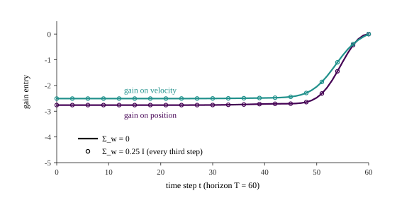

::: {.lecture-video lecture="19"}
:::

*Based on the lecture by Andrew Ng — [CS229](https://cs229.stanford.edu/), Stanford
University, Autumn 2018.*

Fitted value iteration (@sec-cmdp-fvi) handles continuous states by approximating the
value function. This lecture finds the one important case where no approximation is
needed: if the dynamics are linear and the reward quadratic, the value function is
*exactly* quadratic, the optimal policy is *exactly* linear, and both come out of a short
matrix recursion however many state variables there are. Getting there takes two small
generalizations of the MDP first, rewards that depend on the action and a finite horizon,
because the algorithm, the *linear quadratic regulator* (LQR), is most naturally a
backward pass over a fixed number of time steps. Ng's summary is that LQR applies to a
narrow set of problems, but when it applies it is the algorithm to use.

## Rewards that depend on the action {#sec-lqr-state-action}

[4:16]{.t} So far the reward has been a function of the state alone. Letting it depend on
the action too, $R : S \times A \to \mathbb{R}$, makes the payoff

$$
R(s_0, a_0) + \gamma R(s_1, a_1) + \gamma^2 R(s_2, a_2) + \cdots,
$$

and it lets a problem say that actions have costs. A robot in a maze can be charged for
moving and nothing for standing still. A helicopter can be charged for yanking the sticks
hard, which wastes fuel and stresses the airframe. A route planner can charge each road
segment its own cost, and a factory can price sending a maintenance crew differently from
doing nothing. [5:55]{.t} Bellman's equation changes in one visible way:

$$
V^*(s) = \max_a \Bigl[ R(s, a) + \gamma \sum_{s'} P_{sa}(s') V^*(s') \Bigr],
$$ {#eq-lqr-bellman-sa}

with the max now outside the immediate reward, since that reward depends on the action
being chosen. A student checks that the max covers the whole bracket, and it does. Value
iteration uses @eq-lqr-bellman-sa as its update unchanged, and the optimal policy is the
argmax of the same bracket. The reward depends on the current state and action, not on
the next state. Ng notes that other formulations exist and this is one convenient one.

## Finite horizons and policies that watch the clock {#sec-lqr-finite-horizon}

[11:00]{.t} The second generalization replaces the discount factor with a *horizon* $T$.
The MDP runs for $T$ steps and then stops, and the payoff is the finite sum

$$
R(s_0, a_0) + R(s_1, a_1) + \cdots + R(s_T, a_T),
$$

usually without discounting, though discounting is still allowed. Ng's example is a model
helicopter with thirty minutes of fuel: the aim is to collect as much reward as possible
before the clock runs out.

[13:11]{.t} A finite horizon has a consequence that is easy to miss. The best action can
depend on the time. Put a robot between a small $+1$ nearby and a large $+10$ farther off.
With plenty of time it should go for the $+10$. With two or three steps left it should grab
the $+1$, because the $+10$ is out of reach. So the optimal policy is written
$\pi^*_t(s)$, and is called *non-stationary*. [15:46]{.t} Ng points out what was implicit
until now: in the infinite-horizon discounted setting of lectures 16 and 17 the optimal
policy is *stationary*, the same at every step, because the future always looks the same.

[16:31]{.t} Once the policy may change over time, so may the world. A non-stationary MDP
has $P^{(t)}_{sa}$ and $R^{(t)}(s, a)$ indexed by time. Ng gives three examples. A
long-haul airliner can burn a third of its take-off weight in fuel, so it handles
differently on landing. A drive to San Francisco at 5 pm runs into rush hour, and into mud
if the forecast says rain. And in a factory running round the clock, labour costs and
availability change with the shift.

## Solving it backwards {#sec-lqr-dp}

[21:11]{.t} Define $V^*_t(s)$ as the best expected payoff from state $s$ at time $t$ to the
end. With nothing left after the last step, the base case is just the best immediate
reward,

$$
V^*_T(s) = \max_a R(s, a),
$$

[23:27]{.t} and each earlier step looks one step ahead to the next:

$$
V^*_t(s) = \max_a \Bigl[ R(s, a) + \sum_{s'} P_{sa}(s') V^*_{t+1}(s') \Bigr],
\qquad
\pi^*_t(s) = \arg\max_a \Bigl[ \cdots \Bigr].
$$ {#eq-lqr-dp}

This is no longer value iteration in the sense of repeating an update until it converges.
It is *dynamic programming*: compute $V^*_T$, then $V^*_{T-1}$ from it, then $V^*_{T-2}$, down
to $V^*_0$, once each, and read $\pi^*_t$ off at every step. Time-varying $P^{(t)}$ and
$R^{(t)}$ slot into @eq-lqr-dp at no extra cost.

[28:31]{.t} A student asks whether letting $T \to \infty$ recovers ordinary value
iteration. The two are closely related, but undiscounted sums can grow without bound as
$T$ grows. That is one reason discounting exists. If $|R| \le R_{\max}$, a discounted value
is at most $R_{\max}/(1-\gamma)$ in size, and a finite-horizon one at most $(T+1) R_{\max}$.

[30:30]{.t} Ng sketches the $+1$/$+10$ corridor with deterministic moves. With two steps
left, the values read like "10, 10, 10, 1, 1, 1, 0, 0, 0": cells within reach of the $+10$,
cells only within reach of the $+1$, and cells that can reach neither. He suggests building
the little simulator to watch the policy change as the clock runs down. @fig-horizon does
that for an eleven-cell corridor of our own, with the $+10$ in cell 0, the $+1$ in cell 8,
and a state-action reward of $-0.1$ for each move, so that it uses both of this lecture's
generalizations. The generator checks the dynamic programme against brute force over every
action sequence up to seven steps. Cell 5 shows the non-stationarity in full. With one or
two steps left it stays put, since nothing is reachable and moving costs. With three or
four it heads right for the $+1$. With five or more it heads left for the $+10$.

{#fig-horizon}

The figure's caption hides one more lesson. Without discounting and with waiting free,
many cells have *several* optimal actions. Leaving for the $+10$ now or one step later
gives the same total if there is time either way. Discounting is what makes sooner
strictly better.

## The LQR model {#sec-lqr-model}

[32:04]{.t} LQR is a finite-horizon MDP with continuous states $S = \mathbb{R}^n$,
continuous actions $A = \mathbb{R}^d$, and two specific assumptions. The first is that the
dynamics are linear with Gaussian noise:

$$
s_{t+1} = A s_t + B a_t + w_t, \qquad w_t \sim \mathcal{N}(0, \Sigma_w),
$$ {#eq-lqr-dynamics}

with $A \in \mathbb{R}^{n \times n}$ and $B \in \mathbb{R}^{n \times d}$. [34:27]{.t} Ng
apologises for the notation. $A$ is now both the set of actions and a matrix, because LQR
comes from control theory in electrical and mechanical engineering and reinforcement
learning from computer science, and when the two literatures met, their letters clashed.
The same thing happens to $V$ below. [36:30]{.t} The second assumption is a quadratic
reward,

$$
R(s, a) = -\bigl(s^\top U s + a^\top V a\bigr), \qquad U \succeq 0,\; V \succeq 0,
$$ {#eq-lqr-reward}

with $U \in \mathbb{R}^{n \times n}$ and $V \in \mathbb{R}^{d \times d}$ positive
semi-definite, so both terms are costs. For a helicopter that should hover at the origin,
$U = I$ and $V = I$ give $R = -\lVert s \rVert^2 - \lVert a \rVert^2$. That penalises
drifting from the hover point and penalises large control inputs. Time-varying $A_t$,
$B_t$, $U_t$, $V_t$ are allowed but not needed for the derivation.

[40:43]{.t} Where do $A$ and $B$ come from? The first way was lecture 18's
(@eq-cmdp-linear-model): fly the helicopter, log $m$ trajectories, and fit $A$ and $B$ by
least squares. Ng says again that this gives a good model for slow flight.

## Linearizing a nonlinear model {#sec-lqr-linearize}

[43:02]{.t} The second way starts from a nonlinear simulator $s_{t+1} = f(s_t, a_t)$,
from a physics engine or "a friend with a physics degree". Ng tried the inverted
pendulum's equations himself and found them complicated. To make it linear, he draws the
one-dimensional case. [45:31]{.t} Plot $s_{t+1} = f(s_t)$ against $s_t$, pick a point
$\bar s_t$, and replace $f$ with its tangent line there:

$$
s_{t+1} \approx f(\bar s_t) + f'(\bar s_t)\,(s_t - \bar s_t).
$$

[49:05]{.t} The tangent is good near $\bar s_t$ and poor far away, so $\bar s_t$ should be
where the system spends its time: the hover point for a helicopter, the upright pole at
rest for the pendulum. [50:37]{.t} With an action as well, linearize around a typical pair
$(\bar s_t, \bar a_t)$ using the Jacobians:

$$
s_{t+1} \approx f(\bar s_t, \bar a_t)
+ \nabla_s f(\bar s_t, \bar a_t)\,(s_t - \bar s_t)
+ \nabla_a f(\bar s_t, \bar a_t)\,(a_t - \bar a_t).
$$ {#eq-lqr-linearize}

[53:20]{.t} This is affine rather than linear, because of the constant terms. Ng's fix is to
add an intercept to the state, a component fixed at 1. Then
@eq-lqr-linearize takes the form $s_{t+1} = A s_t + B a_t$ after "some algebraic munging".
When the linearization point is the origin and the system rests there, $f(0, 0) = 0$, as
for the upright pendulum, the constants vanish and no intercept is needed.

@fig-pendulum does this for a pendulum on a motorised pivot, with the angle $\theta$
measured from upright and a torque as the action. The only nonlinear term is gravity,
$(g/l)\sin\theta$, and linearizing at $\bar\theta = 0$ replaces it with $(g/l)\theta$. The
generator checks the hand-derived $A$ and $B$ against finite differences. The line is 1%
too strong at 0.25 rad, 4% at 0.5 rad, 19% at 1 rad and 50% at 1.5 rad. The right panel
runs the LQR controller designed on the linear model on the true pendulum. From 0.3 rad
the real and predicted trajectories coincide. From 1.4 rad they come apart by up to
0.11 rad, but the controller still brings the pole up. Feedback forgives a model that is
wrong in the right direction. Because the measured state is fed back every step, the
controller corrects its own model errors as they appear. In this toy, with unlimited
torque, it recovers even from 3 rad. A real motor's torque limit would end that long
before.

{#fig-pendulum}

## The value function is exactly quadratic {#sec-lqr-riccati}

[56:05]{.t} Now run the backward recursion @eq-lqr-dp on the LQR model. With continuous
states, the sum over $s'$ becomes an expectation over $s_{t+1} \sim \mathcal{N}(A s_t + B a_t,
\Sigma_w)$. [57:07]{.t} The base case is immediate:

$$
V^*_T(s_T) = \max_{a_T} \bigl[-s_T^\top U s_T - a_T^\top V a_T\bigr] = -s_T^\top U s_T,
$$

because $a^\top V a \ge 0$, so the best last action is $a_T = 0$. A student notices that
$s^\top U s$ is also non-negative. It is, but it cannot be chosen: only $a_T$ is maximised
over.

[59:09]{.t} The inductive step carries the whole method. Suppose

$$
V^*_{t+1}(s) = s^\top \Phi_{t+1} s + \Psi_{t+1}
$$

for some matrix $\Phi_{t+1} \in \mathbb{R}^{n \times n}$ and scalar $\Psi_{t+1}$. This holds
at $t+1 = T$ with $\Phi_T = -U$ and $\Psi_T = 0$. [1:04:23]{.t} Then

$$
V^*_t(s_t) = \max_{a_t} \Bigl[ -s_t^\top U s_t - a_t^\top V a_t
+ \mathbb{E}_{s_{t+1} \sim \mathcal{N}(A s_t + B a_t,\, \Sigma_w)}\bigl[ s_{t+1}^\top \Phi_{t+1} s_{t+1} \bigr] + \Psi_{t+1} \Bigr].
$$

The expectation of a quadratic under a Gaussian is a quadratic of the mean plus a
constant, $\mathbb{E}[s^\top \Phi s] = \mu^\top \Phi \mu + \operatorname{tr}(\Sigma_w \Phi)$.
So the bracket is a quadratic function of $a_t$, and since $\Phi_{t+1} \preceq 0$ and
$V \succeq 0$ it is concave. [1:06:57]{.t} Setting its derivative to zero gives

$$
a^*_t = -\bigl(B^\top \Phi_{t+1} B - V\bigr)^{-1} B^\top \Phi_{t+1} A \; s_t = L_t\, s_t .
$$ {#eq-lqr-action}

[1:08:03]{.t} Ng stops on this. The optimal action is a *linear* function of the state. He
stresses that this is not a function-approximation claim. Nobody fitted a line to the
optimal action. Of all functions of the state, linear or not, the best one turns out to
be linear. Substituting $a^*_t$ back into the bracket gives another quadratic in $s_t$,
which completes the induction. [1:09:45]{.t} The coefficients obey the *discrete Riccati
equations*:

$$
\begin{aligned}
\Phi_t &= A^\top \Bigl( \Phi_{t+1} - \Phi_{t+1} B \bigl(B^\top \Phi_{t+1} B - V\bigr)^{-1} B^\top \Phi_{t+1} \Bigr) A - U, \\
\Psi_t &= \Psi_{t+1} + \operatorname{tr}\bigl(\Sigma_w \Phi_{t+1}\bigr).
\end{aligned}
$$ {#eq-lqr-riccati}

[1:11:04]{.t} The whole algorithm is to set $\Phi_T = -U$ and $\Psi_T = 0$, then apply
@eq-lqr-riccati and @eq-lqr-action for $t = T-1$ down to $0$, and finally act with
$\pi^*_t(s) = L_t s$. [1:14:08]{.t} What impresses Ng is that nothing in it is approximate.
The approximation happens once, when a real system is forced into the form of a linear
model with a quadratic cost, by regression or by linearization. After that, the value
function really is quadratic and the policy really is linear, and the recursion computes
both exactly.

The generator tests each claim by a second route on a cart with position and velocity
at 10 Hz and a 60-step horizon. At 20 random times and states, a numerical maximisation of
the Bellman bracket lands on $L_t s$ and on $s^\top \Phi_t s + \Psi_t$ to within $10^{-6}$.
None of 400 perturbed policies beats $L_t s$, and half of them add nonlinear terms of the
state and time.

::: {.callout-warning title="Two signs the 2018 notes get wrong"}
cs229-notes13 prints the optimal action without the leading minus sign in
@eq-lqr-action. It also prints $\Psi_t = -\operatorname{tr}(\Sigma_t \Phi_{t+1}) + \Psi_{t+1}$,
and the board in the lecture shows the same minus sign. Both are wrong, and the notes'
own footnote, $\mathbb{E}[w^\top \Phi w] = \operatorname{tr}(\Sigma \Phi)$, gives the plus
sign. The noise should make the value *worse*, and since $\Phi_{t+1} \preceq 0$, only
$+\operatorname{tr}$ does that. Monte Carlo settles it. From $s_0 = (1, 0)$ with
$\Sigma_w = 0.25 I$, 4,000 rollouts of the cart under $L_t$ average $-168.8 \pm 1.1$.
@eq-lqr-riccati predicts $-170.4$, and the printed sign predicts $+152.3$, a positive value
for a problem whose rewards are all negative. The action's sign matters even more. Without
the minus, the controller pushes the cart away from the origin, and the payoff of a single
noiseless run is $-1.4 \times 10^{14}$. The notes also write $B_t$ where $B_t^\top$ is
meant, and $V_t$ and $W_t$ for the same matrix.
:::

::: {.callout-note title="In the official notes"}
Finite-horizon MDPs, LQR and linearization are cs229-notes13, sections 1, 2 and 3.1.
Section 3.2 goes on to *differential dynamic programming*, which re-linearizes around a
trajectory instead of a single point. Section 4 covers LQG, LQR when the state is observed
only through noise, with the Kalman filter. The lecture covers neither.
:::

## The noise does not change the policy {#sec-lqr-noise}

[1:15:22]{.t} Ng ends with a property he calls fun, and warns against generalizing.
Look at what each quantity depends on. $L_t$ in @eq-lqr-action needs $\Phi_{t+1}$ but not
$\Psi_{t+1}$, which makes sense: adding a constant to every future value cannot change which
action is best. $\Phi_t$ in @eq-lqr-riccati needs only $\Phi_{t+1}$. [1:17:36]{.t} The noise
covariance $\Sigma_w$ appears in exactly one place, the update for $\Psi$. Delete the $\Psi$
line from the code and the optimal policy is computed perfectly without $\Sigma_w$ ever
being used. **The optimal LQR policy does not depend on the noise.** The value does: a
helicopter in a gale does worse than one in still air. But the best response to any state
is the same in both.

@fig-gains shows both effects on the cart. The gains computed with $\Sigma_w = 0$ and with
$\Sigma_w = 0.25 I$ are identical to the last bit, while $\Psi_0$ goes from 0 to $-161.4$.
The figure also shows the finite horizon at work. For the first half of the horizon the
gain is flat at $L \approx (-2.76, -2.51)$, a stationary policy in all but name. Over the
last 25 or so steps it relaxes to zero, because there is less and less future in which a
correction would pay off. That is the clock-watching of @fig-horizon in continuous form.

{#fig-gains}

[1:19:00]{.t} Ng draws two lessons. The narrow one is that, when applying LQR, there is no
need to work hard at estimating $\Sigma_w$. The broader one is about practice. For most
MDPs the noise *does* change the policy, and the form of the noise matters. But in his
experience of building robots, remembering to add noise matters more than getting its
size exactly right. Ten per cent more or less rarely matters; a factor of two often does.
That is the same advice as lecture 18's (@sec-cmdp-model), now with one case where it can
be proved.
